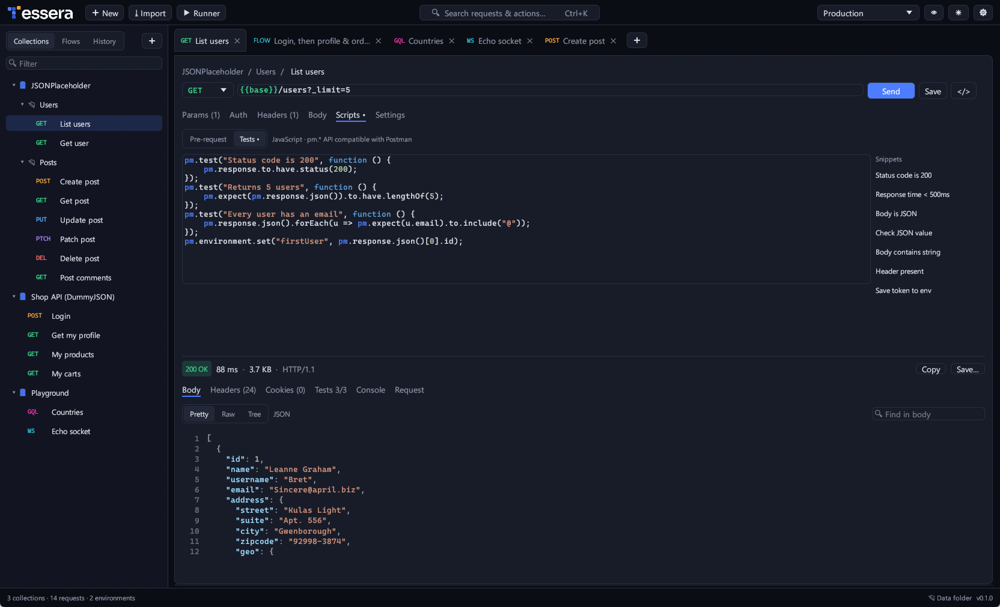
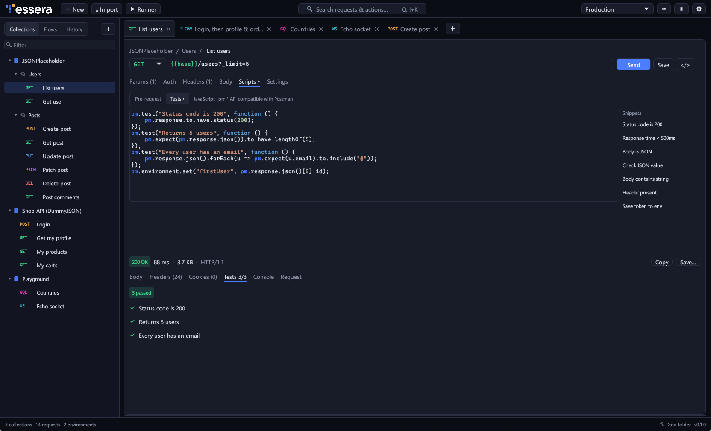
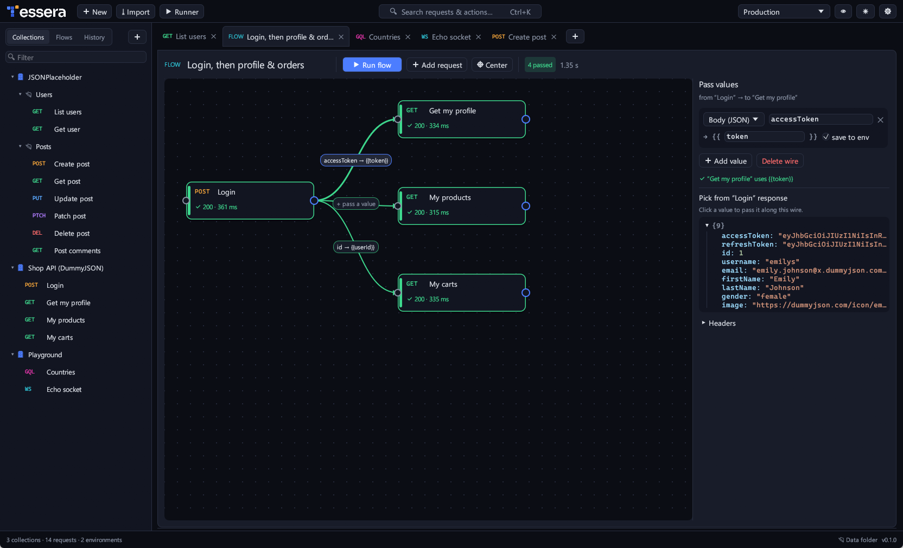
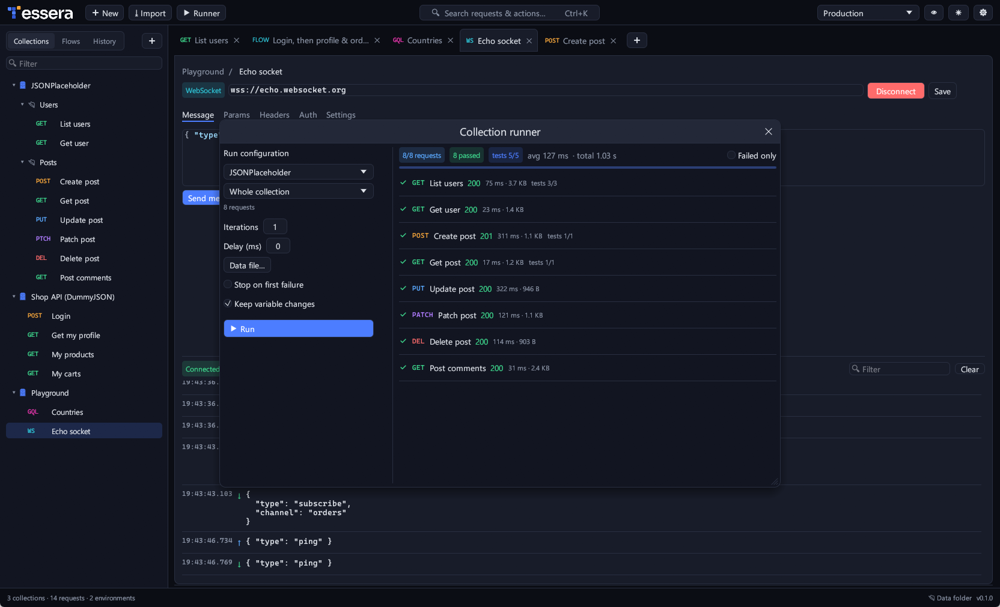
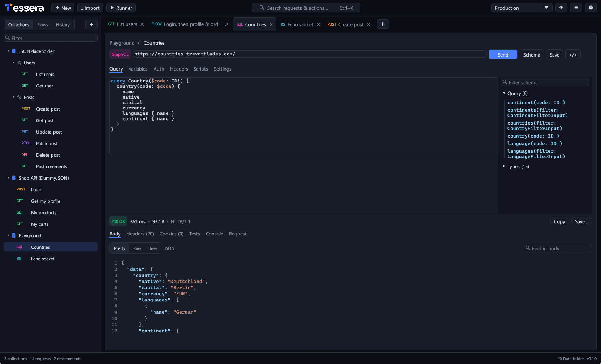
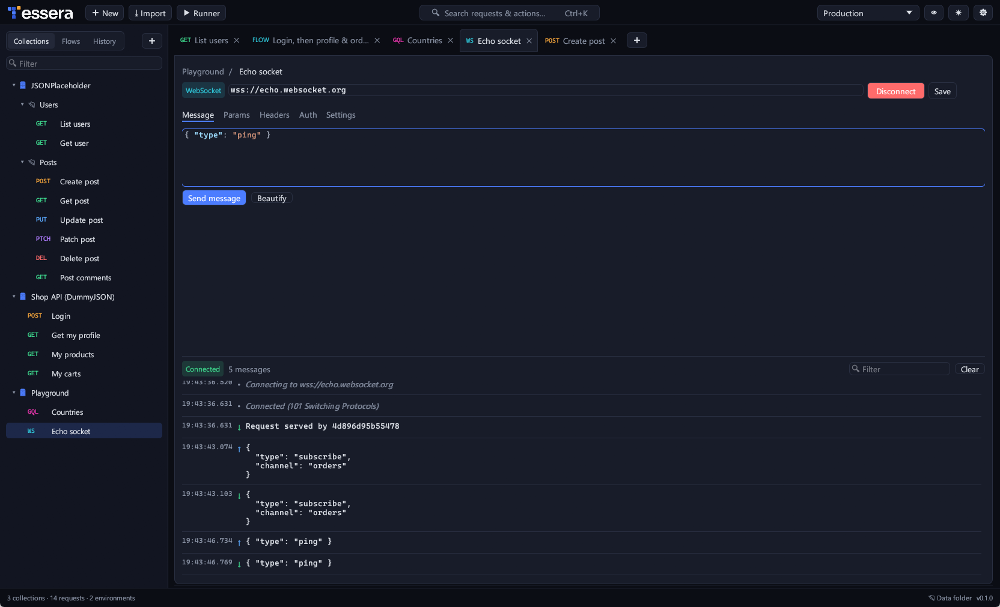
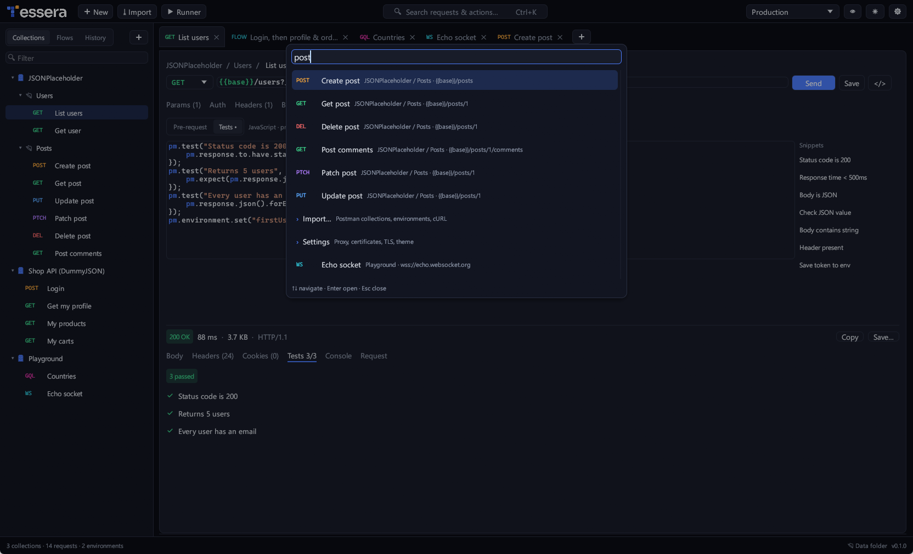
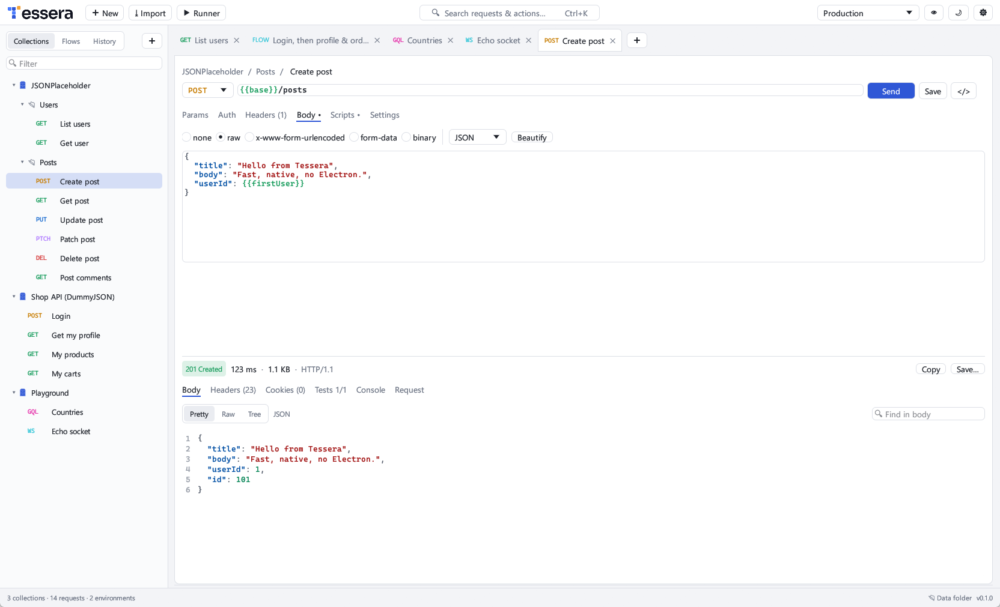

<h1 align="center">
  <picture>
    <source media="(prefers-color-scheme: dark)" srcset="crates/app/assets/brand/wordmark-dark-1000.png">
    
  </picture>
</h1>

<p align="center">
  
  <br>
  <sub>A request with its test script, and the response it got back: status, timing, size and highlighted JSON.</sub>
</p>

<p align="center">
  <b>Build, test and chain HTTP APIs. A fast, native alternative to Postman, written in pure Rust.</b><br>
  One small executable that opens in under half a second and uses no CPU while idle.<br>
  Your collections stay on your machine as plain JSON. No account, no cloud sync, no telemetry.
</p>

<p align="center">
  
  
  
  
  <a href="https://github.com/theoddprince/tessera/actions/workflows/ci.yml"></a>
</p>

<br>

<p align="center">
  <a href="#features">Features</a> ·
  <a href="#flows">Flows</a> ·
  <a href="#keyboard-shortcuts">Shortcuts</a> ·
  <a href="#get-started">Get started</a> ·
  <a href="#roadmap">Roadmap</a> ·
  <a href="#under-the-hood">Under the hood</a> ·
  <a href="#license-and-credits">License</a>
</p>

<br>

<table>
  <tr>
    <td width="25%" valign="top">
      <h3>⚡ Native and light</h3>
      An egui desktop app with no Electron and no web view. A ~14 MB executable that starts in about 0.4 s and sits at 0% CPU when idle.
    </td>
    <td width="25%" valign="top">
      <h3>🧩 Flows</h3>
      Wire requests together on a canvas, for example <i>Login → Orders</i>. Click a field in the login response, such as the token, and it feeds the next request.
    </td>
    <td width="25%" valign="top">
      <h3>🧪 Postman-compatible scripts</h3>
      Pre-request and test scripts with <code>pm.test</code>, <code>pm.expect</code> and <code>pm.environment</code>, running on an embedded JavaScript engine.
    </td>
    <td width="25%" valign="top">
      <h3>📦 Bring your Postman work</h3>
      Import Postman v2.0/v2.1 collections and environments, or paste a cURL command. Export back to Postman at any time.
    </td>
  </tr>
</table>

## Features

### Requests and responses

- **Any HTTP method**, with query params that stay in sync with the URL and headers you can bulk edit.
- **Bodies**: raw (JSON, XML, HTML, text, JavaScript), `x-www-form-urlencoded`, multipart form-data with files, or a binary file.
- **Responses** show status, total time (and time to first byte) and size. The body has four views:
  - **Pretty**: syntax highlighted;
  - **Raw**;
  - **Tree**: a collapsible JSON tree; right-click a node to copy its path or value, or to generate a `pm.expect`;
  - **Preview**: for images.
- **Search inside the body**, and inspect headers, cookies and the exact request that was sent.
- **Large bodies are virtualised.** A 20 MB response scrolls smoothly and never freezes the window.
- **Per-request settings** for timeout, redirects and TLS verification.

### Collections, environments and variables

- **Collections** with nested folders. Drag and drop to reorder; rename, duplicate and delete. Each collection or folder can have its own auth, scripts and variables, and requests inherit auth from their parents.
- **`{{variables}}`** from environments, globals, collection, local and data scopes, with Postman's precedence. Dynamic variables are built in: `{{$guid}}`, `{{$timestamp}}`, `{{$isoTimestamp}}`, `{{$randomInt}}`.
- **Inline highlighting:** a variable is green when it resolves and red when it's missing. Hover to see its value and where it comes from.
- **Secret variables** are masked in the editor.

### Scripts and tests

<p align="center">
  
</p>

- **Pre-request and test scripts**, using the `pm` API you already know from Postman:
  - variables: `pm.environment`, `pm.collectionVariables`, `pm.globals`, `pm.variables`, `pm.iterationData`;
  - request: `pm.request` (`headers.add/upsert/remove`, `url.update`);
  - response: `pm.response` (`code`, `json()`, `text()`, `headers`, `responseTime`, `to.have.status/header/jsonBody`, `to.be.ok/notFound/…`) and `pm.cookies`;
  - tests: `pm.test` and a chai-style `pm.expect` (`equal`, `eql`, `include`, `property`, `lengthOf`, `above`, `below`, `match`, `oneOf`, `keys`, `a/an`, `ok`, `exist`, `empty`, `.not`, `.deep`, …);
  - also `pm.setNextRequest`, `console.log`, `btoa`/`atob`, and the legacy `postman.*` and `tests[...]`.
- **Built-in snippets** for common tests, and a **Console** tab for script output.
- **Runaway scripts are stopped** before they can hang the app.

### Auth and networking

- **Bearer, Basic, API key** (sent in a header or the query string) and **OAuth 2.0**:
  - Authorization Code with PKCE, which opens your browser;
  - Client Credentials and Password grants;
  - refreshing an existing token.
- **Proxy, custom CA certificates, and per-host client certificates** (PEM or PFX). TLS verification can be switched off for local and test servers.
- **A persistent cookie jar**, so a login cookie is sent with later requests, just like in a browser.

<a id="flows"></a>
### Flows: chain requests visually

<p align="center">
  
</p>

Most APIs need a token before they return data. With Postman you write a script to copy the token from one response into the next request. In Tessera you draw it:

1. **Drag requests** from the sidebar onto the canvas.
2. **Connect them**: drag from a step's ● to the next step.
3. **Click the wire** and click the field you need in the previous response, for example `accessToken`. The wire now carries `accessToken → {{token}}`.
4. **Press ▶ Run flow.** Steps run in wire order and each box turns green or red, with its status and time. If a step fails, the steps after it are skipped and say why.

A wire can carry a body field (`data.items[0].id`), a header or the status code. **Use as Bearer token** sets up the next request with one click. **Save to env** keeps the value in your environment, so you can also send the next request by hand.

### Collection runner

<p align="center">
  
</p>

- **Run a whole collection or a single folder**, with iterations and a delay between requests.
- **Data-driven runs** from a CSV or JSON file: one iteration per row, available as `{{column}}` and `pm.iterationData`.
- **Stop on first failure**, `setNextRequest` branching, and live per-request results with test details.

### GraphQL and WebSocket

<p>
  
  
</p>

- **GraphQL**: query and variables editors with highlighting. **Schema** fetches the schema by introspection and lists every field; click one to insert it with its sub-fields.
- **WebSocket**: connect with custom headers and auth, send messages, and follow a timestamped, filterable log of incoming and outgoing messages.

### Find anything, in any theme

<p>
  
  
</p>

- **Command palette** (Ctrl+K): fuzzy-search every request, environment and action.
- **Dark and light themes**, UI scaling, tabs restored on restart, unsaved-change markers, and history grouped by day.
- **Code snippets** for any request as cURL, PowerShell, Python (requests) or JavaScript (fetch).

## Keyboard shortcuts

| Keys | Action |
|---|---|
| **Ctrl+Enter** | Send. In a WebSocket tab, connect, then send. In a flow tab, run the flow. |
| **Ctrl+S** | Save the request |
| **Ctrl+T** / **Ctrl+N** | New tab |
| **Ctrl+W** | Close tab |
| **Ctrl+Tab** / **Ctrl+Shift+Tab** | Next / previous tab |
| **Ctrl+K** / **Ctrl+P** | Command palette |
| **Ctrl+L** | Focus the URL bar |
| **Esc** | Cancel the running request |

You can also paste a cURL command into the URL bar to turn it into a request, or drop Postman files onto the window to import them.

## Get started

### Download

Get the latest **`tessera-…-windows-x64.exe`** from [Releases](https://github.com/theoddprince/tessera/releases/latest). It's a single file with nothing to install. Windows 10/11 x64 is required.

> The executable isn't code-signed yet. If Windows SmartScreen says *"Windows protected your PC"*, click **More info → Run anyway**.

### Build from source

You need a stable Rust toolchain from [rustup.rs](https://rustup.rs). On Windows you also need the MSVC build tools.

```sh
git clone https://github.com/theoddprince/tessera
cd tessera
cargo build --release
./target/release/tessera          # Windows: target\release\tessera.exe
```

To publish a new release, push a version tag (`git tag v0.2.0 && git push origin v0.2.0`). The [Release workflow](.github/workflows/release.yml) builds, tests and attaches the executable automatically.

| OS | Notes |
|---|---|
| **Windows 10/11** | The main target: builds as-is with the MSVC toolchain, and the executable carries the Tessera icon. |
| **Linux / macOS** | The engine (`tessera-core`) builds and is tested in CI on both. The desktop app is untested there; on Linux it needs the usual GTK/X11 development packages for its file dialogs. |

**Your data** is stored as plain JSON in `%APPDATA%\Tessera\Tessera\data`, with one file per collection; **Data folder** in the status bar opens it. Set `TESSERA_DATA_DIR` to keep it somewhere else, for example in a synced folder or next to a portable copy.

## Roadmap

Tessera is in early alpha.

| Feature | Status |
|---|---|
| HTTP requests, collections, environments, variables | ✅ Available |
| Pre-request and test scripts (`pm` API), console | ✅ Available |
| Flows (visual request chaining) | ✅ Available |
| Collection runner with CSV/JSON data | ✅ Available |
| GraphQL with schema introspection, WebSocket | ✅ Available |
| OAuth 2.0, client certificates, proxy | ✅ Available |
| Postman import/export, cURL import, code snippets | ✅ Available |
| `pm.sendRequest` and `require()` in scripts | ⏳ Next |
| Digest, AWS Signature, NTLM auth | ⏳ Planned |
| Rendered HTML preview | ⏳ Planned |
| gRPC and Socket.IO | ⏳ Planned |
| Installers (MSI, `.dmg`, AppImage) | ⏳ Planned |

## Under the hood

```text
crates/core   tessera-core: the engine, with no GUI dependencies
              model, {{variable}} resolution, HTTP (reqwest), auth and OAuth 2.0,
              the script sandbox (Boa) with the pm API, the collection runner,
              flows, WebSocket, GraphQL introspection, Postman/cURL import and
              export, and JSON storage
crates/app    tessera: the desktop app (egui / eframe): theme, widgets, panels,
              the flow canvas, and a bridge to a background tokio runtime
```

- **The UI never waits on the network.** Every request runs on a background tokio runtime, and results come back over a channel. A slow server can't freeze the window.
- **Only what's visible is drawn.** Response bodies are pretty-printed off the UI thread and rendered line by line, only for the rows on screen.
- **Scripts are sandboxed.** They run in an embedded JavaScript engine with loop and recursion limits, so a `while (true) {}` can't hang the app.
- **Tested end to end without the internet.** Integration tests start local HTTP and WebSocket servers and run the full pipeline against them: scripts, forms, cookies, redirects, chained runner variables, and a flow that passes a login token to the next request.
- **CI** lints and tests the engine on Windows, Linux and macOS, and builds the desktop app on Windows, for every push.

## License and credits

The code is dual-licensed under [MIT](LICENSE-MIT) or [Apache-2.0](LICENSE-APACHE), at your option.

- The Tessera logo and wordmark in [`crates/app/assets`](crates/app/assets) belong to the project owner; please use them only to refer to Tessera.
- The screenshots use made-up demo data and public test APIs: [JSONPlaceholder](https://jsonplaceholder.typicode.com), [DummyJSON](https://dummyjson.com), the [Countries GraphQL API](https://countries.trevorblades.com) and [echo.websocket.org](https://echo.websocket.org).
